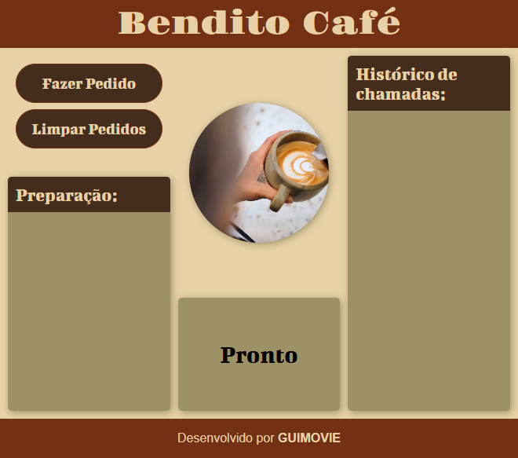
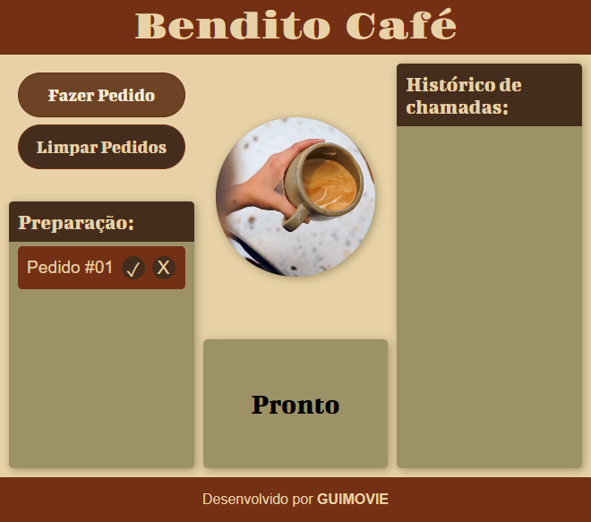
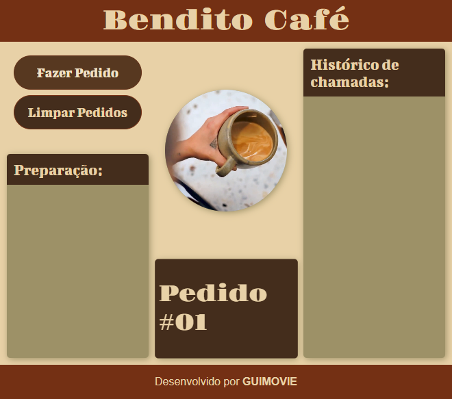

# Painel de Atendimento — Bendito Café

Projeto do primeiro semestre do curso de ADS. Aplicação web simples para acompanhar os pedidos de uma cafeteria. O painel organiza os pedidos em preparação, destaca o pedido pronto e mantém um histórico das chamadas anteriores.

## Capturas de tela

### Painel inicial

### Pedido em preparação

### Pedido pronto

## Como usar

1. Clique em **Fazer Pedido** para adicionar um pedido à lista de preparação.
2. Na preparação, use **✓** para marcar o pedido como pronto. Ele será destacado no painel e anunciado por voz, se o navegador oferecer suporte.
3. Use **X** para cancelar um pedido ainda em preparação.
4. Ao marcar outro pedido como pronto, o pedido pronto anterior vai para o histórico. O histórico mantém até sete chamadas.
5. Clique em **Limpar Pedidos** para limpar as listas e reiniciar a numeração.

## Tecnologias

- HTML
- CSS
- JavaScript sem dependências
- API de síntese de voz do navegador para anunciar pedidos prontos

